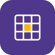

<p align="center">
  
</p>

<h1 align="center">Kronos</h1>

<p align="center">
  <a href="LICENSE"></a>
</p>

Kronos is a private, offline-first Android app for keeping a class schedule, assignments, and exams in one place. It is designed for everyday use on older Android phones as well as newer devices.

There is no account, backend, or required internet connection. Your schedule and tasks stay on your device.

## What you can do

- Add subjects with colors for quick identification.
- Build a weekly timetable with class times, rooms, teachers, and week numbers.
- Track assignments and other tasks with due dates, priorities, categories, notes, and completion status.
- Add exams with dates, times, rooms, seats, notes, and subjects.
- Receive reminders for upcoming classes, tasks, and exams.
- View the timetable from an Android home-screen widget.
- Change appearance and time-format preferences.
- Export a backup and restore it later, including when moving to another device.
- Export timetable data as CSV when you need to work with it elsewhere.

## Getting started

1. Install the debug APK or build a personal release APK from Android Studio.
2. Add your subjects first.
3. Add class sessions to build the timetable.
4. Add tasks and exams, optionally linking them to subjects.
5. Enable reminders in the app if you want notifications.
6. Create a backup regularly from the app's backup settings.

Kronos does not sync data between devices. Use the built-in backup and restore flow when transferring your data.

## Project stack

- Kotlin and XML views
- AndroidX and Material Components
- Room 2.7.2 for local SQLite persistence
- KSP for Room code generation
- Coroutines and Lifecycle
- Android notification channels, `AlarmManager`, and broadcast receivers
- Android home-screen widgets
- LeakCanary 2.14 in debug builds only

The app targets SDK 35, supports Android API 26 and newer, and is currently version `1.0` with version code `1`.

## Architecture

The code is organized by responsibility:

```text
app/src/main/java/com/example/kronos/
├── data/                 Repositories, settings, backup, and data access
│   └── local/            Room entities, DAOs, converters, and database
├── notifications/        Alarm scheduling, receivers, and notification channels
├── ui/
│   ├── exams/            Exam screens, editor, adapter, and ViewModel
│   ├── tasks/            Task screens, editor, adapter, and ViewModel
│   └── timetable/        Timetable screens, editor, adapters, and ViewModel
├── widget/               AppWidget provider and widget rendering
└── lib/                  Shared formatting, colors, scheduling, and view helpers
```

Room is the source of truth for application data. ViewModels expose repository flows to the UI, and lifecycle-scoped collectors update views only while their view lifecycle is active. Reminder scheduling is kept separate from UI and database code.

## Performance and low-end device work

Kronos is intentionally built as a small, local-first app for responsive use on older hardware, including Android 8 devices:

- Room queries, backup and restore, CSV export, widget rendering, and reminder rescheduling run off the main thread with coroutines and `Dispatchers.IO`.
- `StateFlow` streams use lifecycle-aware collection and `SharingStarted.WhileSubscribed` so database observation is not kept active unnecessarily.
- RecyclerView screens use `ListAdapter` and `DiffUtil` rather than rebuilding every visible row.
- Fragment view bindings, adapters, callbacks, and widget-related view references are released in `onDestroyView()` to avoid retaining destroyed screens.
- Reminder delivery uses `AlarmManager` and schedules only the next relevant class boundary instead of polling continuously.
- The widget does not use periodic polling (`updatePeriodMillis` is `0`); it refreshes on explicit changes and schedules the next needed update.
- Widget database work and rendering preparation happen asynchronously, while `RemoteViews` layouts use Android-compatible concrete views for older launchers.
- The app avoids a backend, sync engine, login flow, analytics, and network work, reducing background work, storage use, and battery impact.
- Room uses KSP code generation instead of kapt, keeping the build pipeline lighter and avoiding runtime reflection for generated database access.
- The release build enables R8 minification and resource shrinking with the optimized Android configuration, reducing the APK and removing unused code and resources.
- LeakCanary is debug-only, so leak detection is available during development without increasing the release APK.

## Building from source

- JDK 17
- Android SDK with API 26 and API 36.1 platform/build tools
- A physical Android device or emulator

The project includes the Gradle wrapper, so use `./gradlew` rather than relying on a globally installed Gradle version.

Open the repository in Android Studio and run the `app` debug configuration.

Useful commands:

```bash
./gradlew :app:testDebugUnitTest
./gradlew :app:assembleDebug
```

The debug variant includes LeakCanary automatically and does not minify or shrink resources. To inspect a leak report, open and dismiss the relevant screen several times, recreate the screen, and open the LeakCanary notification if one appears.

## Release build

The release build is configured for personal daily use, including on a low-end Android 8 device:

- R8 minification is enabled.
- Resource shrinking is enabled.
- The optimized Android ProGuard configuration and `app/proguard-rules.pro` are applied.
- It uses the debug signing configuration so no keystore or password files are required.
- LeakCanary is debug-only and is not packaged into the release APK.

The debug signing configuration is suitable for installing a private build on a personal device. It is not suitable for publishing or distributing an official signed release.

## Data and privacy

Kronos stores its database locally and does not require network access, login, analytics, or a remote service. Backup and restore use local JSON files. Treat exported backups as private because they can contain your timetable, tasks, subjects, exams, and settings.

Local database files, SQLite files, and signing material are ignored by Git. Do not commit personal timetable or task data.

## Database changes

Room schema exports are stored under `app/schemas`. When changing entities or DAOs:

1. Update the entity, DAO, repository, and related UI as needed.
2. Add a Room migration when the schema changes.
3. Keep the exported schema files in sync.
4. Verify backup import/export compatibility for affected fields.

## Licensing

The project is licensed under GPL-3.0. Third-party libraries retain their own licenses. The bundled notification sound is distributed under CC0 1.0 Universal.
